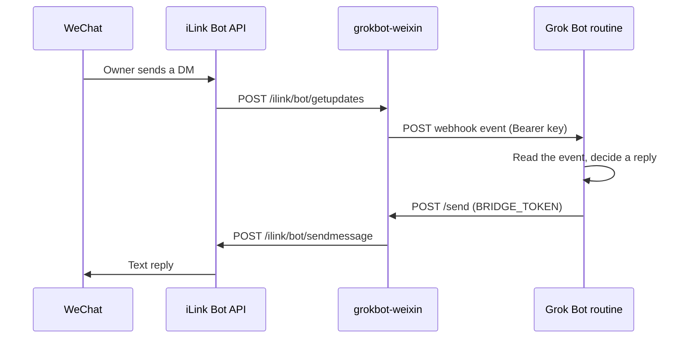

# grokbot-weixin

Bridge one WeChat (Weixin) direct-message account to a [Grok Bot](https://grok.com) routine.

A single always-on process logs in through the Weixin iLink Bot API, long-polls inbound messages, POSTs each direct message to a Grok Bot webhook routine, and sends the routine's text reply back to WeChat. The same TypeScript core runs on Cloudflare Workers or on Node.js 22.

The protocol follows Tencent's official OpenClaw channel plugin, [openclaw-weixin](https://github.com/Tencent/openclaw-weixin) (MIT). This repository is a standalone reimplementation. It does not import or run the OpenClaw runtime. The wire format was checked against that project's `docs/protocol.md`, `src/api/api.ts`, `src/api/types.ts`, `src/auth/login-qr.ts`, and the monitor and send paths (package 2.4.10 at the time of writing). `src/core/json.ts` uses the same uint64-quoting approach as upstream so `message_id` values above `2^53-1` stay exact. Thank you to the openclaw-weixin authors.



## What this version does

- QR login (`get_bot_qrcode`, `get_qrcode_status`), including redirect hosts and the verify-code step.
- One `getupdates` long poll at a time, with a persisted cursor and a 200-id dedupe ring.
- Text replies through `sendmessage`, using the latest stored `context_token` for that peer.
- Optional typing indicator (`getconfig` + `sendtyping`) after a webhook is accepted.
- A sender allowlist. The first WeChat account that scans the QR, or the first inbound sender when that id is absent, can be pinned. Unknown senders are logged by id and dropped.
- `POST /send` protected by a bearer token (SHA-256 then constant-time compare) and a sliding one-minute rate limit.

Media bytes stay on the Weixin CDN. The webhook event includes the media kind, file name, and voice transcript (`voice_item.text`) when the API sends them. Image, file, and video decryption is not implemented. The upstream CDN path uses AES-128-ECB; copying that into v1 was left out on purpose.

Upstream's channel metadata describes this API as direct messages only (`chatTypes: ["direct"]`, group policy disabled). Messages that carry `group_id` are ignored. Bot echoes (`message_type` 2, or `from_user_id` equal to the account id) are ignored.

## Layout

| Path | Role |
| --- | --- |
| `src/core` | iLink client, QR state machine, one poll step, webhook, `/send`, login page. Uses `fetch`, Web Crypto, and an injected storage interface. |
| `src/worker` | Cloudflare Worker plus one SQLite Durable Object named `owner`. An alarm runs one poll, writes state, and reschedules. |
| `src/node` | Node.js 22 CLI. State files live in `~/.grokbot-weixin/` (directory `0700`, files `0600`). |
| `test` | Vitest against an in-memory iLink fetch mock. |

Runtime dependency: [`uqr`](https://www.npmjs.com/package/uqr) for the login QR (SVG in the browser, Unicode in the terminal).

## Configuration

Copy `.env.example` to `.env` for the Node runner. On Cloudflare, non-secrets can live in `wrangler.toml` `[vars]`. Secrets use `wrangler secret put`.

| Variable | Default | Meaning |
| --- | --- | --- |
| `ILINK_API_BASE` | `https://ilinkai.weixin.qq.com` | QR login and API host until a confirm response returns `baseurl`. |
| `ILINK_CDN_BASE` | `https://novac2c.cdn.weixin.qq.com/c2c` | Recorded for later media work. v1 does not call it. |
| `ILINK_BOT_TYPE` | `3` | Query value on `get_bot_qrcode`. |
| `ILINK_APP_ID` | `bot` | `iLink-App-Id`. |
| `ILINK_CHANNEL_VERSION` | `0.1.0` | Encoded into `iLink-App-ClientVersion` as `major<<16 \| minor<<8 \| patch`. |
| `ILINK_BOT_AGENT` | `GrokBotWeixin/0.1.0` | `base_info.bot_agent`. Must match `Name/Version`. |
| `ILINK_ROUTE_TAG` | empty | Optional `SKRouteTag`. |
| `WEIXIN_BOT_TOKEN` | empty | Optional seed. Both this and `WEIXIN_ACCOUNT_ID` are required. |
| `WEIXIN_ACCOUNT_ID` | empty | iLink bot id (`ilink_bot_id`). |
| `WEIXIN_BASE_URL` | empty | Optional per-account API base from a previous login. |
| `WEIXIN_OWNER_USER_ID` | empty | Scanner id. Pinned when the allowlist is empty. |
| `WEIXIN_ALLOW_FROM` | empty | Comma-separated sender ids. When set, this list replaces the stored allowlist. |
| `WEIXIN_PIN_FIRST_SENDER` | `true` | Pin the scanner, otherwise the first inbound sender, when the allowlist is empty. |
| `GROK_WEBHOOK_URL` | empty | Grok Bot routine webhook URL. Polling continues when this is empty; events are not delivered. |
| `GROK_WEBHOOK_KEY` | empty | Sender key from the routine panel. |
| `GROK_WEBHOOK_HEADER` | `Authorization` | Header that carries the key. Confirm this in the routine panel. |
| `GROK_WEBHOOK_SCHEME` | `Bearer` | Prefix before the key. `raw` sends the key with no prefix. |
| `BRIDGE_PUBLIC_URL` | empty | Internet origin of this bridge, with no path. Written into `reply.url` as `{origin}/send`. |
| `BRIDGE_TOKEN` | empty | Bearer token for `/send`, `/login`, and `/admin/*`. Empty rejects every protected call. |
| `BRIDGE_HOST` | `127.0.0.1` | Node listen address. Docker sets `0.0.0.0`. |
| `BRIDGE_PORT` | `8787` | Node listen port. |
| `SEND_TYPING` | `true` | Send a typing indicator after a successful webhook forward. |
| `LONG_POLL_TIMEOUT_MS` | `35000` | Client timeout for `getupdates`, clamped to 5–60 seconds. |
| `WEBHOOK_MAX_ATTEMPTS` | `4` | Attempts for 429, 5xx, and network errors. Other 4xx are not retried. |
| `RATE_LIMIT_SEND_PER_MINUTE` | `30` | Sliding window for HTTP `POST /send`. |
| `GROKBOT_STATE_DIR` | `~/.grokbot-weixin` | Node only. |

Generate a bridge token with `openssl rand -base64 32`.

Logs are structured JSON. They include account and sender ids, message ids, HTTP status, and iLink `ret` codes. They omit message bodies, webhook keys, bot tokens, context tokens, and QR secrets.

## Webhook event

`POST` JSON, schema `grokbot-weixin.inbound.v1`:

```json
{
  "schema": "grokbot-weixin.inbound.v1",
  "account_id": "bot@im.wechat",
  "sender": { "id": "owner@im.wechat", "name": null },
  "message_id": "123",
  "timestamp_ms": 1700000000000,
  "type": "text",
  "state": "finished",
  "text": "hello",
  "media": [],
  "context_token": "ctx",
  "chat_type": "direct",
  "reply": {
    "method": "POST",
    "url": "https://bridge.example/send",
    "headers": {
      "Content-Type": "application/json",
      "Authorization": "Bearer <BRIDGE_TOKEN>"
    },
    "body": {
      "to": "owner@im.wechat",
      "text": "<reply text>",
      "context_token": "ctx",
      "account": "bot@im.wechat"
    }
  }
}
```

`sender.name` is always `null`. The upstream message type has no display name. `reply.headers.Authorization` is the literal placeholder `Bearer <BRIDGE_TOKEN>`. The real token stays in the routine's secret store. `type` is `text`, `image`, `voice`, `file`, `video`, `mixed`, or `unknown`. Voice transcript text is copied into `text` when the message has no text items. `state` maps `message_state` 0/1/2 to `new` / `generating` / `finished`.

Webhook retries wait 200 ms, 800 ms, then 2 s. A failed forward is logged and the cursor still advances, so one bad message cannot stall polling. A crash after the POST and before the dedupe write can deliver the same message again.

### Sample Grok Bot routine prompt

Paste this into the routine that receives the webhook. Store `BRIDGE_TOKEN` as a routine secret. The webhook URL and sender key are configured on the bridge (`GROK_WEBHOOK_URL`, `GROK_WEBHOOK_KEY`), and the header name must match the routine panel (`GROK_WEBHOOK_HEADER`, default `Authorization: Bearer <key>`).

```text
You receive WeChat messages as JSON webhook events (schema grokbot-weixin.inbound.v1).

Read sender.id, text, type, media, and context_token. sender.name is always null.
Image, file, and video bytes are not attached. Voice messages may include a transcript in text.

Reply by POST to the event's reply.url (this is the bridge /send endpoint).
Use the Authorization header "Bearer" plus the BRIDGE_TOKEN secret. Never print that token.
Body JSON: {"to": reply.body.to, "text": "<your reply>", "context_token": reply.body.context_token, "account": reply.body.account}.
When the bridge allowlist has exactly one sender, omit "to" to send a proactive message to that sender. The response does not include the WeChat id.
Keep the reply as plain text under 4000 characters.

Stay silent when no reply is needed: do not call /send, and do not send a placeholder.
Ignore events whose sender is unexpected. Do not invent a different recipient.
```

`POST /send` body is `{ "to"?, "text", "context_token"?, "account"? }`. `to` is optional when the allowlist has exactly one sender; the bridge delivers to that stored id and does not return it. The id is whatever pinning saved (`from_user_id`), including values outside the printable-ASCII check. If `to` is omitted and the allowlist is empty or has more than one entry, the response is HTTP 400 `recipient_required`. An explicit `to` that is already allowlisted is sent as given. Any other explicit `to` must be a single-line visible id or the response is HTTP 400 `bad_request`; a well-formed id that is not allowlisted is HTTP 403. `account` must match the logged-in bot id when present. `context_token` is optional; the bridge uses the newest token stored for that sender. HTTP 409 `context_token_rejected` means iLink returned `ret: -2`. HTTP 429 means the rate limit fired.

## Cloudflare Workers (primary)

One Worker, one SQLite Durable Object (`AccountDurableObject`, instance name `owner`). Each alarm performs a single `getupdates` call. Storage writes happen after the fetch returns, so a `/send` that arrives during the long poll can run. The alarm handler catches errors and reschedules. `setAlarm` replaces any previous alarm.

Workers Free includes SQLite Durable Objects. Figures below are from the Cloudflare docs as of October 2026 ([Workers limits](https://developers.cloudflare.com/workers/platform/limits/), [Durable Objects pricing](https://developers.cloudflare.com/durable-objects/platform/pricing/)):

- 100,000 requests per day. Alarm invocations count.
- Duration 13,000 GB-s per day, billed at 128 MB. A bridge that is awake all day is about `86400 * 128/1024 ≈ 10,800` GB-s. That fits, with limited room for a second always-on object or a long local debug session on the same account.
- CPU time on Free is 10 ms per invocation. Waiting on `fetch` does not spend CPU. A consistently over-limit invocation is killed. Move to the Node runner or Workers Paid if logs show CPU cancellations.
- Alarm wall time is 15 minutes. The long poll is 35 seconds, under that cap.
- SQLite: 100,000 row writes per day and 5 million row reads. Each `setAlarm` is one row write. An idle 35-second poll is one alarm write when the cursor and dedupe set do not change.
- 50 subrequests per invocation. One poll uses one `getupdates`, one webhook (up to four attempts), and sometimes `getconfig` plus `sendtyping`.

A healthy long poll therefore uses about `86400 / 35 ≈ 2,500` requests per day. If `getupdates` returns an empty batch immediately, the next alarm waits out the poll window instead of looping. A burst of inbound messages polls again after 250 ms.

### Deploy

```bash
npm install
npx wrangler login
openssl rand -base64 32   # this value is BRIDGE_TOKEN
npx wrangler secret put BRIDGE_TOKEN
npx wrangler secret put GROK_WEBHOOK_URL
npx wrangler secret put GROK_WEBHOOK_KEY
# optional, if the routine panel uses a different header:
npx wrangler secret put GROK_WEBHOOK_HEADER
npx wrangler secret put GROK_WEBHOOK_SCHEME
# optional seed, instead of the QR page:
npx wrangler secret put WEIXIN_BOT_TOKEN
npx wrangler secret put WEIXIN_ACCOUNT_ID
npx wrangler deploy
```

After the first deploy, set the public origin and redeploy is unnecessary for a secret (the next request sees it):

```bash
npx wrangler secret put BRIDGE_PUBLIC_URL
# value: https://grokbot-weixin.<account>.workers.dev   (no trailing slash)
```

You can also set `BRIDGE_PUBLIC_URL` under `[vars]` in `wrangler.toml` if you prefer it in git. Leave the token and the webhook key out of that file.

Login, pick one:

1. Open `https://<your-worker>/login`, enter `BRIDGE_TOKEN`, scan the QR with WeChat, and confirm. If WeChat shows a code, type it on the page.
2. On a machine with a terminal, `npx grokbot-weixin login`, then `npx grokbot-weixin export-session --out session.json`, then:

```bash
curl -sS -X POST "https://<your-worker>/admin/session" \
  -H "Authorization: Bearer $BRIDGE_TOKEN" \
  -H "Content-Type: application/json" \
  --data-binary @session.json
```

`session.json` contains the bot token. Delete it after import. The admin response does not echo the token.

A seeded token does not start polling until something hits the Worker. `GET /health` is enough: it runs inside the Durable Object and arms the alarm when the seed creates a session.

```bash
curl -sS "https://<your-worker>/health"
```

`/health` reports `logged_in`, `allowlist_count`, and `paused`. It does not return ids, cursors, or secrets.

Allowlist updates without a redeploy:

```bash
curl -sS -X POST "https://<your-worker>/admin/allowlist" \
  -H "Authorization: Bearer $BRIDGE_TOKEN" \
  -H "Content-Type: application/json" \
  -d '{"allow_from":["owner@im.wechat"]}'
```

## Mac Studio (launchd + Cloudflare Tunnel)

The Grok Bot routine runs in the cloud, so `POST /send` has to be reachable from the internet. The Node process should keep listening on `127.0.0.1`. Put Cloudflare Tunnel in front of it.

```bash
npm install
npm run build:node
cp .env.example .env
# edit .env: BRIDGE_TOKEN, GROK_WEBHOOK_*, BRIDGE_PUBLIC_URL
node dist/node/cli.js login
chmod +x scripts/install-launchd.sh
./scripts/install-launchd.sh
```

`scripts/install-launchd.sh` is macOS-only. It writes `~/Library/LaunchAgents/com.grokbot.weixin.plist` from `launchd/com.grokbot.weixin.plist`, with the current Node binary, repo path, and home directory filled in. Logs go to `~/Library/Logs/grokbot-weixin.log` and `grokbot-weixin.err.log`.

Quick tunnel (the URL changes every run; update `BRIDGE_PUBLIC_URL` and the routine when it changes):

```bash
cloudflared tunnel --url http://127.0.0.1:8787
```

For a stable hostname, create a named tunnel and point it at `http://127.0.0.1:8787`, then set `BRIDGE_PUBLIC_URL` to that hostname. Restart the launchd agent after editing `.env` (`launchctl kickstart -k gui/$(id -u)/com.grokbot.weixin`).

On Linux, run the Docker image below, or supervise `node dist/node/cli.js start` with your own service manager. The launchd script exits on other operating systems.

## Docker

```bash
docker build -t grokbot-weixin .
docker run --rm -p 8787:8787 \
  -v grokbot-weixin:/data \
  -e BRIDGE_TOKEN \
  -e BRIDGE_PUBLIC_URL \
  -e GROK_WEBHOOK_URL \
  -e GROK_WEBHOOK_KEY \
  -e GROK_WEBHOOK_HEADER \
  -e WEIXIN_BOT_TOKEN \
  -e WEIXIN_ACCOUNT_ID \
  grokbot-weixin
```

The image listens on `0.0.0.0:8787` and stores state in `/data`. Publish that port only on a private network, then expose `/send` through an authenticated tunnel or reverse proxy. The container still requires `BRIDGE_TOKEN`.

## Node CLI

Requires Node.js 22 or newer.

```text
grokbot-weixin login [--timeout-ms N]
grokbot-weixin start
grokbot-weixin send --to <id> --text <text>
grokbot-weixin allow <id>
grokbot-weixin export-session --out <file>
```

`login` prints a Unicode QR and the URL encoded in it. Default wait is 8 minutes. The bot token is stored under the state directory and is not printed. `start` serves `/health`, `/login`, `/send`, and `/admin/*` on `127.0.0.1:8787` and runs the poll loop until SIGINT or SIGTERM. `send` does not apply the HTTP rate limit. `allow` appends one sender id. `export-session` writes a mode `0600` JSON file for `POST /admin/session`.

## HTTP API

| Method and path | Auth | Behavior |
| --- | --- | --- |
| `GET /health` | none | Status flags only. |
| `GET /login` | token form, then cookie | QR page. Cookie name `gb_session`, `HttpOnly`, `SameSite=Strict`, 12 hours. `Secure` on HTTPS. |
| `POST /login/session` | form token | Sets the cookie and redirects to `/login`. |
| `POST /login/start` | bearer or cookie | Fetches a QR. `?force=1` replaces a current QR. |
| `GET /login/status` | bearer or cookie | One status poll. |
| `POST /login/verify` | bearer or cookie | Body `{ "code": "123456" }`. |
| `POST /admin/session` | bearer or cookie | Body `{ "bot_token", "account_id", "base_url"?, "user_id"? }`. |
| `POST /admin/allowlist` | bearer or cookie | Body `{ "allow_from": ["id"] }` (max 20). |
| `POST /send` | bearer or cookie | Body `{ "to"?, "text", "context_token"?, "account"? }`. `to` is optional when exactly one sender is allowlisted. Text limit 8000 characters. |

Authorization accepts `Authorization: Bearer <BRIDGE_TOKEN>` or the login cookie. Comparison hashes both strings with SHA-256 and compares the digests, so the check does not leak the secret's length. Values longer than 512 characters are rejected.

## Security

- The bot token is the WeChat credential. On Node it is a `0600` file in a `0700` directory. On Cloudflare it lives in Durable Object storage. The Worker secret `WEIXIN_BOT_TOKEN` is only the seed.
- `/send` is how the routine talks to your WeChat account. Keep `BRIDGE_TOKEN` in a secret, and publish the endpoint only over HTTPS.
- The allowlist is the access-control list. With `WEIXIN_PIN_FIRST_SENDER=true` and an empty list, the first scanner or the first inbound sender is pinned and later senders are ignored. Set `WEIXIN_ALLOW_FROM` before login if someone else might message the bot first.
- `/send` refuses peers that are not on the allowlist, including when you pass your own `to`.
- The webhook event tells the model how to call `/send` and uses a placeholder for the token. Put the real token in the routine secret, not in the prompt.
- Login QR responses returned to the browser omit the raw `qrcode` secret and the bot token. The SVG is generated locally from the QR URL.

## Known limits

- Direct messages only, matching upstream's stated channel scope. Group messages are dropped.
- `context_token` is required by the send API in practice. Upstream issue [openclaw-weixin#225](https://github.com/Tencent/openclaw-weixin/issues/225) reports an empirical lifetime of about 48 hours and `ret: -2` with an empty `errmsg` when the token is stale. That lifetime and the meaning of `-2` are not in `docs/protocol.md`. This bridge maps `-2` to HTTP 409 and otherwise sends the stored token. Whether `sendmessage` accepts a body with no `context_token` was not confirmed.
- A stale session returns iLink `-14` (documented in upstream `session-guard.ts`). Polling pauses for one hour. Log in again if it continues.
- Typing tickets are cached for 10 minutes locally. That TTL is not part of the protocol.
- QR codes last about 5 minutes. The client refreshes twice (three codes total) and then stops.
- `qrcode_img_content` is treated as the string to encode in a QR (a URL), which matches how upstream renders it. The URL itself is not downloaded.
- After `confirmed`, later API calls use `baseurl` from that response when it is present. QR login itself always starts at `ILINK_API_BASE`.
- iLink user ids in the wild often end with `@im.wechat`. The bridge accepts any printable ASCII id up to 160 characters because the protocol doc does not fix the alphabet.
- `getupdates` may echo the bot's own messages. Those are skipped. Whether that echo always happens was not re-checked against a live account.
- Workers Free CPU is 10 ms. Duration headroom is small if anything else on the account is always on.
- One bad webhook cannot stop the cursor. It also cannot be retried forever; the routine will not see that message again unless WeChat delivers it with a new id.
- No real WeChat account is contacted by `npm test`. See Development.

## Development

```bash
npm install
npm test
npm run build
```

`npm test` runs Vitest. `npm run build` typechecks the Node runner, typechecks the Worker, and runs `wrangler deploy --dry-run`.

Tests cover header construction, the QR state machine, cursor persistence, dedupe, webhook retry, `/send` authentication, the allowlist, and file modes `0700` / `0600`. The iLink server is a mock `fetch`. A live QR scan, a live `getupdates` session, and a live Grok Bot routine were not run.

## 中文说明

这是一个把微信私聊接到 Grok Bot routine 的桥。协议对齐腾讯开源的 [openclaw-weixin](https://github.com/Tencent/openclaw-weixin)（MIT），代码是独立实现，不依赖 OpenClaw。

推荐部署在 Cloudflare Workers：一个 Worker 加一个 SQLite Durable Object，用 alarm 做长轮询。Mac 上可以用 Node 加 launchd，再用 Cloudflare Tunnel 把本机的 `/send` 暴露到公网，因为 routine 在云端，必须能访问这个地址。

主人需要做的事：

1. `openssl rand -base64 32` 生成 `BRIDGE_TOKEN`。
2. 在 Grok Bot routine 面板拿到 webhook URL 和 sender key，核对请求头（默认 `Authorization: Bearer <key>`），填到 `GROK_WEBHOOK_URL`、`GROK_WEBHOOK_KEY`、`GROK_WEBHOOK_HEADER`。
3. Cloudflare：`wrangler secret put` 写入 `BRIDGE_TOKEN`、`GROK_WEBHOOK_URL`、`GROK_WEBHOOK_KEY`，`wrangler deploy`，再 `wrangler secret put BRIDGE_PUBLIC_URL` 为 Worker 的 https 源站。
4. 浏览器打开 `https://<worker>/login`，输入 `BRIDGE_TOKEN`，用微信扫码确认。或在本机 `login` 后用 `export-session` 和 `POST /admin/session` 导入。
5. 若使用了环境变量里的 token 而不是扫码，先访问一次 `GET /health`，轮询才会开始。
6. 把上面的英文 routine 提示词贴进 routine，并把 `BRIDGE_TOKEN` 放进 routine 的 secret。收到消息后，routine 按事件里的 `reply` 字段调用 `/send`。白名单里只有一个发送者时，主动发消息可以省略 `to`。
7. 白名单默认钉住扫码的微信号。若要手工指定，设置 `WEIXIN_ALLOW_FROM` 或调用 `POST /admin/allowlist`。

`npm test` 和 `npm run build` 只针对模拟的 iLink 服务。真实微信扫码无法在 CI 里完成。

## License

MIT. See [LICENSE](LICENSE). Copyright 2026 Pan YANG.
