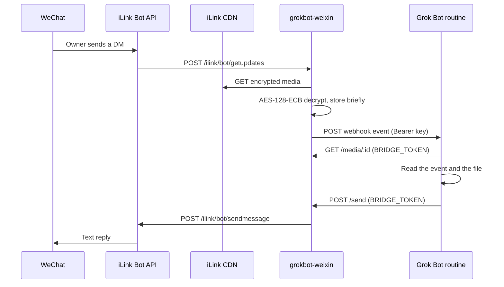

# grokbot-weixin

Bridge one WeChat (Weixin) direct-message account to a [Grok Bot](https://grok.com) routine.

A single always-on process logs in through the Weixin iLink Bot API, long-polls inbound messages, POSTs each direct message to a Grok Bot webhook routine, and sends the routine's text reply back to WeChat. The same TypeScript core runs on Cloudflare Workers or on Node.js 22.

The protocol follows Tencent's official OpenClaw channel plugin, [openclaw-weixin](https://github.com/Tencent/openclaw-weixin) (MIT). This repository is a standalone reimplementation. It does not import or run the OpenClaw runtime. The wire format was checked against that project's `docs/protocol.md`, `src/api/api.ts`, `src/api/types.ts`, `src/auth/login-qr.ts`, and the monitor and send paths (package 2.4.10 at the time of writing). `src/core/json.ts` uses the same uint64-quoting approach as upstream so `message_id` values above `2^53-1` stay exact. Thank you to the openclaw-weixin authors.



## What this version does

- QR login (`get_bot_qrcode`, `get_qrcode_status`), including redirect hosts and the verify-code step.
- One `getupdates` long poll at a time, with a persisted cursor and a 200-id dedupe ring.
- Text replies through `sendmessage`, using the latest stored `context_token` for that peer.
- Optional typing indicator (`getconfig` + `sendtyping`) after a webhook is accepted.
- A sender allowlist. The first WeChat account that scans the QR, or the first inbound sender when that id is absent, can be pinned. Unknown senders are logged by id and dropped.
- `POST /send` protected by a bearer token (SHA-256 then constant-time compare) and a sliding one-minute rate limit.
- Inbound images, voice, files, and video. The bridge downloads the iLink CDN object, decrypts it with AES-128-ECB and PKCS#7 (the same transform as openclaw-weixin), and keeps the plaintext until `MEDIA_TTL_MS`. The webhook event carries `GET /media/:id`, the mime type, and the size. That GET uses the same bearer token as `/send`.
- A per-sender transcript of recent inbound messages and successful outbound texts, included on each webhook as `history`. A message whose whole text is `/new` or `/reset` clears that transcript and is not forwarded.
- A private history page. `POST /history/session` with the bridge bearer token returns a one-shot link. Opening it sets an HttpOnly cookie and redirects to `/history`, which renders the stored transcript.

Voice notes copy `voice_item.text` into `text` when the message has no typed text, and always into `media[].transcript`. The Node runner transcodes SILK to WAV when decoding succeeds. The Worker stores the raw SILK bytes (`audio/silk`) and still forwards the transcript. The history page plays that SILK in the browser. A quoted message is attached as `quote`.

Upstream's channel metadata describes this API as direct messages only (`chatTypes: ["direct"]`, group policy disabled). Messages that carry `group_id` are ignored. Bot echoes (`message_type` 2, or `from_user_id` equal to the account id) are ignored.

## Layout

| Path | Role |
| --- | --- |
| `src/core` | iLink client, QR state machine, one poll step, webhook, `/send`, `GET /media/:id`, AES-128-ECB, login page. Uses `fetch`, Web Crypto, and injected storage. |
| `src/worker` | Cloudflare Worker plus one SQLite Durable Object named `owner`. An alarm runs one poll, writes state, stores decrypted media in that same database, and reschedules. The poll does not decode SILK. |
| `src/node` | Node.js 22 CLI. State files live in `~/.grokbot-weixin/` (directory `0700`, files `0600`). Decrypted media is under `media/`. SILK voice is decoded with `silk-wasm`. |
| `test` | Vitest against an in-memory iLink fetch mock. |

Runtime dependency: [`uqr`](https://www.npmjs.com/package/uqr) for the login QR (SVG in the browser, Unicode in the terminal).

## Configuration

Copy `.env.example` to `.env` for the Node runner. On Cloudflare, non-secrets can live in `wrangler.toml` `[vars]`. Secrets use `wrangler secret put`.

| Variable | Default | Meaning |
| --- | --- | --- |
| `ILINK_API_BASE` | `https://ilinkai.weixin.qq.com` | QR login and API host until a confirm response returns `baseurl`. |
| `ILINK_CDN_BASE` | `https://novac2c.cdn.weixin.qq.com/c2c` | Used when a media item has `encrypt_query_param` and no usable `full_url`. The GET is `{base}/download?encrypted_query_param=`. |
| `ILINK_BOT_TYPE` | `3` | Query value on `get_bot_qrcode`. |
| `ILINK_APP_ID` | `bot` | `iLink-App-Id`. |
| `ILINK_CHANNEL_VERSION` | `0.1.0` | Encoded into `iLink-App-ClientVersion` as `major<<16 \| minor<<8 \| patch`. |
| `ILINK_BOT_AGENT` | `GrokBotWeixin/0.1.0` | `base_info.bot_agent`. Must match `Name/Version`. |
| `ILINK_ROUTE_TAG` | empty | Optional `SKRouteTag`. |
| `WEIXIN_BOT_TOKEN` | empty | Optional seed. Both this and `WEIXIN_ACCOUNT_ID` are required. |
| `WEIXIN_ACCOUNT_ID` | empty | iLink bot id (`ilink_bot_id`). |
| `WEIXIN_BASE_URL` | empty | Optional per-account API base from a previous login. |
| `WEIXIN_OWNER_USER_ID` | empty | Scanner id. Pinned when the allowlist is empty. |
| `WEIXIN_ALLOW_FROM` | empty | Comma-separated sender ids. When set, this list replaces the stored allowlist. |
| `WEIXIN_PIN_FIRST_SENDER` | `true` | Pin the scanner, otherwise the first inbound sender, when the allowlist is empty. |
| `GROK_WEBHOOK_URL` | empty | Grok Bot routine webhook URL. Polling continues when this is empty; events are not delivered. |
| `GROK_WEBHOOK_KEY` | empty | Sender key from the routine panel. |
| `GROK_WEBHOOK_HEADER` | `Authorization` | Header that carries the key. Confirm this in the routine panel. |
| `GROK_WEBHOOK_SCHEME` | `Bearer` | Prefix before the key. `raw` sends the key with no prefix. |
| `BRIDGE_PUBLIC_URL` | empty | Internet origin of this bridge, with no path. Written into `reply.url` as `{origin}/send`. |
| `BRIDGE_TOKEN` | empty | Bearer token for `/send`, `/login`, and `/admin/*`. Empty rejects every protected call. |
| `BRIDGE_HOST` | `127.0.0.1` | Node listen address. Docker sets `0.0.0.0`. |
| `BRIDGE_PORT` | `8787` | Node listen port. |
| `SEND_TYPING` | `true` | Send a typing indicator after a successful webhook forward. |
| `LONG_POLL_TIMEOUT_MS` | `35000` | Client timeout for `getupdates`, clamped to 5–60 seconds. |
| `WEBHOOK_MAX_ATTEMPTS` | `4` | Attempts for 429, 5xx, and network errors. Other 4xx are not retried. |
| `RATE_LIMIT_SEND_PER_MINUTE` | `30` | Sliding window for HTTP `POST /send`. `GET /media/:id` is not counted. |
| `MEDIA_TTL_MS` | `900000` | How long `GET /media/:id` keeps working. Clamped to 1 minute–24 hours. |
| `MEDIA_MAX_BYTES` | `10485760` | Largest decrypted object stored (10 MiB). Clamped to 64 KiB–32 MiB. |
| `MEDIA_MAX_TOTAL_BYTES` | `67108864` | Total decrypted bytes kept at once (64 MiB). Oldest objects are deleted first. Raised to at least `MEDIA_MAX_BYTES`, and clamped to 256 MiB. |
| `MEDIA_TRANSCODE_VOICE` | `true` | On Node, try to store SILK voice as WAV. The Worker does not decode SILK while ingesting, so voice there stays `audio/silk`. The history page can play that file in the browser. |
| `HISTORY_MAX_TURNS` | `30` | Recent turns kept per sender. Clamped to 0–100. `0` disables history and deletes what was stored. |
| `HISTORY_MAX_CHARS` | `12000` | Budget for stored text plus media summaries and quote text. Clamped to 0–48000. `0` disables history. |
| `HISTORY_TTL_MS` | `86400000` | Drop turns older than this (24 hours). Clamped to 1 minute–30 days. |
| `HISTORY_RESET` | `true` | When `true`, a message whose entire text is `/new` or `/reset` clears that sender's history, sends a short confirmation on WeChat, and is not forwarded. |
| `HISTORY_VIEW_TTL_MS` | `900000` | Lifetime of a history link and the cookie it redeems into (15 minutes). Clamped to 1–30 minutes. |
| `GROKBOT_STATE_DIR` | `~/.grokbot-weixin` | Node only. Media files go in `media/` under this directory. History is one file per sender in the state directory. |

Generate a bridge token with `openssl rand -base64 32`.

Logs are structured JSON. They include account and sender ids, message ids, HTTP status, and iLink `ret` codes. They omit message bodies, webhook keys, bot tokens, context tokens, QR secrets, CDN query parameters, and AES keys.

## Webhook event

`POST` JSON, schema `grokbot-weixin.inbound.v1`:

```json
{
  "schema": "grokbot-weixin.inbound.v1",
  "account_id": "bot@im.wechat",
  "sender": { "id": "owner@im.wechat", "name": null },
  "message_id": "123",
  "timestamp_ms": 1700000000000,
  "type": "mixed",
  "state": "finished",
  "text": "hello",
  "media": [
    {
      "kind": "image",
      "file_name": "image.jpg",
      "transcript": null,
      "has_cdn_reference": true,
      "mime_type": "image/jpeg",
      "size": 12345,
      "url": "https://your-worker.example.workers.dev/media/0123456789abcdef0123456789abcdef",
      "expires_at_ms": 1700000900000,
      "duration_ms": null,
      "error": null
    }
  ],
  "quote": {
    "title": "earlier note",
    "text": "the quoted text",
    "message_id": "122",
    "media": []
  },
  "history": [
    {
      "role": "assistant",
      "text": "what time is the dinner?",
      "type": "text",
      "media": [],
      "quote": null,
      "at_ms": 1699999000000,
      "message_id": "120"
    }
  ],
  "context_token": "ctx",
  "chat_type": "direct",
  "reply": {
    "method": "POST",
    "url": "https://your-worker.example.workers.dev/send",
    "headers": {
      "Content-Type": "application/json",
      "Authorization": "Bearer <BRIDGE_TOKEN>"
    },
    "body": {
      "to": "owner@im.wechat",
      "text": "<reply text>",
      "context_token": "ctx",
      "account": "bot@im.wechat"
    }
  }
}
```

`sender.name` is always `null`. The upstream message type has no display name. `reply.headers.Authorization` is the literal placeholder `Bearer <BRIDGE_TOKEN>`. The real token stays in the routine's secret store. `reply.url` and every media `url` use `BRIDGE_PUBLIC_URL`. The host above is a placeholder.

`type` is `text`, `image`, `voice`, `file`, `video`, `mixed`, or `unknown`, from the sender's own items. A message that is only a quote is classified from the quote. `state` maps `message_state` 0/1/2 to `new` / `generating` / `finished`.

`text` is the sender's own text. When that is empty, it is the voice transcript. When that is also empty, it is the quoted text. The transcript is always also on `media[].transcript` (and `quote.media[].transcript` for a quoted voice note), so a caption plus a voice note does not hide the transcript.

`history` is the recent conversation with this sender, oldest first. It does not include the current message. Each turn:

| Field | Meaning |
| --- | --- |
| `role` | `user` for an inbound WeChat message, `assistant` for text this bridge successfully sent. Proactive `POST /send` and `grokbot-weixin send` are `assistant` turns too. |
| `text` | The turn's text. For a user turn this is the same `text` the webhook used at the time. |
| `type` | `text`, `image`, `voice`, `file`, `video`, `mixed`, or `unknown`. Assistant turns are `text`. |
| `media` | `{ "kind", "file_name", "transcript" }` for that turn's own attachments. No `url`, mime type, or size. |
| `quote` | `null`, or `{ "title", "text", "message_id", "media" }` for a quoted message. `media` uses the same summary shape. |
| `at_ms` | Unix milliseconds. User turns use the WeChat timestamp when it is present. |
| `message_id` | WeChat id, or the bridge `client_id` when a send response has no id. |

The list is capped by `HISTORY_MAX_TURNS`, `HISTORY_MAX_CHARS`, and `HISTORY_TTL_MS`. Older turns are dropped first. A single turn that is still over the character budget has its `text` shortened. Turns are stored per sender in the account Durable Object, and on Node as one `0600` file per sender. The file name is a hash, so the WeChat id is not in the path. Download URLs are not stored. A failed `/send` is not recorded. The current user turn is saved before the webhook returns, so a reply sent during that run is ordered after it. History reads and writes are best-effort. Once iLink has accepted a message, `POST /send` still returns success, and a history error does not drop or repeat the webhook. A failed read leaves the stored transcript as it was.

A message whose entire text is `/new` or `/reset` (case-insensitive, surrounding space ignored) clears that sender's history when `HISTORY_RESET` is true. The bridge replies on WeChat with `Started a new conversation.` and does not call the webhook. That confirmation is not kept in history.

`quote` is `null` when the message does not reference another message. Otherwise:

| Field | Meaning |
| --- | --- |
| `title` | `ref_msg.title`, the server's short summary. |
| `text` | Quoted text, or the quoted voice transcript. |
| `message_id` | `ref_msg.svr_id`, when WeChat sent one. |
| `media` | Quoted attachments. Same object shape as top-level `media`. One level of `ref_msg` is followed. |

Each `media` object:

| Field | Meaning |
| --- | --- |
| `kind` | `image`, `voice`, `file`, or `video`. |
| `file_name` | Name to save as. Files keep a sanitized WeChat name. Generated names look like `image.jpg`, `voice.wav`, `voice.silk`, `video.mp4`. |
| `transcript` | `voice_item.text`, or `null`. |
| `has_cdn_reference` | The item included `full_url` or `encrypt_query_param`. |
| `mime_type` | Content-Type of the stored bytes, or `null`. |
| `size` | Decrypted size in bytes, or `null`. |
| `url` | `GET {BRIDGE_PUBLIC_URL}/media/{id}`, or `null` when the bytes were not stored. The id is 32 hex characters. The URL does not contain the token. |
| `expires_at_ms` | Unix milliseconds. After this, the GET returns 404. |
| `duration_ms` | Voice `playtime` in milliseconds, or `null`. |
| `error` | `null` when `url` is set. Otherwise one of `no_reference`, `no_key`, `download_failed`, `decrypt_failed`, `too_large`, `too_many`, `storage_failed`, `public_url_missing`. |

Download the bytes with the same bearer token as `/send`:

```bash
curl -fsSL -H "Authorization: Bearer $BRIDGE_TOKEN" -o image.jpg "$url"
```

The response body is the decrypted file. `Content-Type` is `mime_type`. Images, audio, and video are `Content-Disposition: inline`. Other files are `attachment`.

Decryption matches openclaw-weixin. The CDN object is AES-128-ECB with PKCS#7 padding. Images prefer `image_item.aeskey` (32 hex characters), then `media.aes_key`. An image with a CDN locator and no key is stored as downloaded. Voice, files, and video require `media.aes_key`: base64 of 16 raw bytes, or base64 of a 32-character hex key. `full_url` is used when it is public `https`. Otherwise the bridge GETs `{ILINK_CDN_BASE}/download?encrypted_query_param=`. Private, loopback, and link-local hosts in `full_url` are not fetched.

Voice `encode_type` 7 (or an MP3 bitstream) is stored as `audio/mpeg`. `encode_type` 1 (PCM) is wrapped as `audio/wav` on both runtimes. SILK (`encode_type` 6, or absent, which is the usual WeChat voice note) becomes `audio/wav` on the Node runner when `silk-wasm` decodes it. The Worker does not decode SILK on the poll path: the stored file is `audio/silk`, and the transcript is the text the routine should read. The history page decodes that SILK in the browser. `encode_type` 5 is `audio/amr` and 8 is `audio/ogg`, unchanged.

`error: "no_key"` means voice, file, or video had a CDN locator and no usable AES key. The transcript is still set when WeChat sent one. `too_large` means the declared size or the downloaded object exceeded `MEDIA_MAX_BYTES`. `too_many` means the message had more than 8 downloadable attachments, counting the quote. `public_url_missing` means `BRIDGE_PUBLIC_URL` is empty, so no URL could be built and the bytes were not stored.

On Cloudflare the plaintext is chunked into 64 KB SQLite rows on the account Durable Object (a row cannot exceed 2 MB). On Node the files are `$GROKBOT_STATE_DIR/media/<id>.bin` with mode `0600`. Expired rows are deleted on the next successful poll and when a GET finds them. No R2 bucket is required.

Webhook retries wait 200 ms, 800 ms, then 2 s. A failed forward is logged and the cursor still advances, so one bad message cannot stall polling. A crash after the POST and before the dedupe write can deliver the same message again. A failed download does not drop the rest of the message: that slot's `error` is set and the webhook is still sent.

### Sample Grok Bot routine prompt

Paste this into the routine that receives the webhook. Store `BRIDGE_TOKEN` as a routine secret. The webhook URL and sender key are configured on the bridge (`GROK_WEBHOOK_URL`, `GROK_WEBHOOK_KEY`), and the header name must match the routine panel (`GROK_WEBHOOK_HEADER`, default `Authorization: Bearer <key>`).

```text
You receive WeChat messages as JSON webhook events (schema grokbot-weixin.inbound.v1).

Read sender.id, text, type, media, quote, history, and context_token. sender.name is always null.
history is the recent conversation with this sender, oldest first. It does not include the current message.
Each history entry has role ("user" or "assistant"), text, type, media, quote, at_ms, and message_id.
assistant means text this bridge already sent, including a proactive /send. user means an earlier WeChat message.
Use history before interpreting a short reply. "OK" may be answering the previous assistant question.
history media and history quote.media have kind, file_name, and transcript. They have no url.
They may also have id and mime_type when bytes were stored. id is not a download link and may already have expired.
text is the sender's own words, or the voice transcript when they sent no text, or the quoted text when both of those are empty.
Voice transcripts come from WeChat (voice_item.text). The bridge does not run speech recognition.
Voice transcripts are also on media[].transcript and quote.media[].transcript. Read those even when text is a caption.
quote is a message they referenced: quote.title, quote.text, quote.message_id, and quote.media.

When a media object has a url and error is null, download it before you answer. It expires at expires_at_ms.
curl -fsSL -H "Authorization: Bearer $BRIDGE_TOKEN" -o /tmp/wechat-media "$url"
Use mime_type and file_name. Images are ordinary image files; open the saved file and look at it.
Voice from the Node bridge is often audio/wav. Voice from the Cloudflare bridge is often audio/silk (raw WeChat SILK); prefer the transcript, and only listen when the file is wav or mp3.
Skip objects whose error is not null.

Reply by POST to the event's reply.url (this is the bridge /send endpoint).
Use the Authorization header "Bearer" plus the BRIDGE_TOKEN secret. Never print that token.
Body JSON: {"to": reply.body.to, "text": "<your reply>", "context_token": reply.body.context_token, "account": reply.body.account}.
When the bridge allowlist has exactly one sender, omit "to" to send a proactive message to that sender. The response does not include the WeChat id.
Keep the reply as plain text under 4000 characters.

Stay silent when no reply is needed: do not call /send, and do not send a placeholder.
Ignore events whose sender is unexpected. Do not invent a different recipient.

When they ask to read the conversation on a page, mint a link and send only that URL.
POST {origin}/history/session where origin is reply.url without the /send suffix.
Authorization is "Bearer" plus the BRIDGE_TOKEN secret. Never print that token, and never put it in a URL.
Body {} when one sender is allowlisted, or {"peer": reply.body.to} when you must name one.
The JSON is {"ok":true,"url":"https://.../history/r/<code>","expires_at_ms":...}.
Send url to the user. The code works once, then the browser keeps a short-lived cookie. The link stops working at expires_at_ms.
```

`POST /send` body is `{ "to"?, "text", "context_token"?, "account"? }`. `to` is optional when the allowlist has exactly one sender; the bridge delivers to that stored id and does not return it. The id is whatever pinning saved (`from_user_id`), including values outside the printable-ASCII check. If `to` is omitted and the allowlist is empty or has more than one entry, the response is HTTP 400 `recipient_required`. An explicit `to` that is already allowlisted is sent as given. Any other explicit `to` must be a single-line visible id or the response is HTTP 400 `bad_request`; a well-formed id that is not allowlisted is HTTP 403. `account` must match the logged-in bot id when present. `context_token` is optional; the bridge uses the newest token stored for that sender. HTTP 409 `context_token_rejected` means iLink returned `ret: -2`. HTTP 429 means the rate limit fired.

## Cloudflare Workers (primary)

One Worker, one SQLite Durable Object (`AccountDurableObjectV2`, instance name `owner`). Each alarm performs a single `getupdates` call. Storage writes happen after the fetch returns, so a `/send` that arrives during the long poll can run. The alarm handler catches errors and reschedules. `setAlarm` replaces any previous alarm.

Migration `v2` renames the previous class `AccountDurableObject` to `AccountDurableObjectV2`. Deploy applies it once. The SQLite database moves with the instance: the WeChat bot token, account id, allowlist, cursor, history, and stored media stay put. A new QR login is not required. `GET /health` reports `history_view: true` when this class is the one answering.

Workers Free includes SQLite Durable Objects. Figures below are from the Cloudflare docs as of October 2026 ([Workers limits](https://developers.cloudflare.com/workers/platform/limits/), [Durable Objects pricing](https://developers.cloudflare.com/durable-objects/platform/pricing/)):

- 100,000 requests per day. Alarm invocations count.
- Duration 13,000 GB-s per day, billed at 128 MB. A bridge that is awake all day is about `86400 * 128/1024 ≈ 10,800` GB-s. That fits, with limited room for a second always-on object or a long local debug session on the same account.
- CPU time on Free is 10 ms per invocation. Waiting on `fetch` does not spend CPU. A consistently over-limit invocation is killed. Move to the Node runner or Workers Paid if logs show CPU cancellations.
- Alarm wall time is 15 minutes. The long poll is 35 seconds, under that cap.
- SQLite: 100,000 row writes per day and 5 million row reads. Each `setAlarm` is one row write. An idle 35-second poll is one alarm write when the cursor and dedupe set do not change.
- 50 subrequests per invocation. One poll uses one `getupdates`, one CDN GET per attachment (at most 8), one webhook (up to four attempts), and sometimes `getconfig` plus `sendtyping`.

A healthy long poll therefore uses about `86400 / 35 ≈ 2,500` requests per day. If `getupdates` returns an empty batch immediately, the next alarm waits out the poll window instead of looping. A burst of inbound messages polls again after 250 ms.

### Deploy

```bash
npm install
npx wrangler login
openssl rand -base64 32   # this value is BRIDGE_TOKEN
npx wrangler secret put BRIDGE_TOKEN
npx wrangler secret put GROK_WEBHOOK_URL
npx wrangler secret put GROK_WEBHOOK_KEY
# optional, if the routine panel uses a different header:
npx wrangler secret put GROK_WEBHOOK_HEADER
npx wrangler secret put GROK_WEBHOOK_SCHEME
# optional seed, instead of the QR page:
npx wrangler secret put WEIXIN_BOT_TOKEN
npx wrangler secret put WEIXIN_ACCOUNT_ID
npx wrangler deploy
```

After the first deploy, set the public origin and redeploy is unnecessary for a secret (the next request sees it):

```bash
npx wrangler secret put BRIDGE_PUBLIC_URL
# value: https://your-worker.example.workers.dev   (no trailing slash)
```

You can also set `BRIDGE_PUBLIC_URL` under `[vars]` in `wrangler.toml` if you prefer it in git. Leave the token and the webhook key out of that file.

Inbound media does not add a secret, a binding, or an R2 bucket. `wrangler.toml` stays as it is. Decrypted bytes live in the account Durable Object until `MEDIA_TTL_MS` (default 15 minutes). Optional `MEDIA_TTL_MS`, `MEDIA_MAX_BYTES`, and `MEDIA_MAX_TOTAL_BYTES` can be `[vars]` when the defaults are wrong. `BRIDGE_PUBLIC_URL` must be set or each media object is stored nowhere and `error` is `public_url_missing`.

Conversation history uses that same Durable Object key-value table. It adds no secret and no binding. Optional `[vars]` are `HISTORY_MAX_TURNS`, `HISTORY_MAX_CHARS`, `HISTORY_TTL_MS`, `HISTORY_RESET`, and `HISTORY_VIEW_TTL_MS`.

Login, pick one:

1. Open `https://<your-worker>/login`, enter `BRIDGE_TOKEN`, scan the QR with WeChat, and confirm. If WeChat shows a code, type it on the page.
2. On a machine with a terminal, `npx grokbot-weixin login`, then `npx grokbot-weixin export-session --out session.json`, then:

```bash
curl -sS -X POST "https://<your-worker>/admin/session" \
  -H "Authorization: Bearer $BRIDGE_TOKEN" \
  -H "Content-Type: application/json" \
  --data-binary @session.json
```

`session.json` contains the bot token. Delete it after import. The admin response does not echo the token.

A seeded token does not start polling until something hits the Worker. `GET /health` is enough: it runs inside the Durable Object and arms the alarm when the seed creates a session.

```bash
curl -sS "https://<your-worker>/health"
```

`/health` reports `logged_in`, `allowlist_count`, and `paused`. It does not return ids, cursors, or secrets.

Allowlist updates without a redeploy:

```bash
curl -sS -X POST "https://<your-worker>/admin/allowlist" \
  -H "Authorization: Bearer $BRIDGE_TOKEN" \
  -H "Content-Type: application/json" \
  -d '{"allow_from":["owner@im.wechat"]}'
```

## Mac Studio (launchd + Cloudflare Tunnel)

The Grok Bot routine runs in the cloud, so `POST /send` has to be reachable from the internet. The Node process should keep listening on `127.0.0.1`. Put Cloudflare Tunnel in front of it.

```bash
npm install
npm run build:node
cp .env.example .env
# edit .env: BRIDGE_TOKEN, GROK_WEBHOOK_*, BRIDGE_PUBLIC_URL
node dist/node/cli.js login
chmod +x scripts/install-launchd.sh
./scripts/install-launchd.sh
```

`scripts/install-launchd.sh` is macOS-only. It writes `~/Library/LaunchAgents/com.grokbot.weixin.plist` from `launchd/com.grokbot.weixin.plist`, with the current Node binary, repo path, and home directory filled in. Logs go to `~/Library/Logs/grokbot-weixin.log` and `grokbot-weixin.err.log`.

Quick tunnel (the URL changes every run; update `BRIDGE_PUBLIC_URL` and the routine when it changes):

```bash
cloudflared tunnel --url http://127.0.0.1:8787
```

For a stable hostname, create a named tunnel and point it at `http://127.0.0.1:8787`, then set `BRIDGE_PUBLIC_URL` to that hostname. Restart the launchd agent after editing `.env` (`launchctl kickstart -k gui/$(id -u)/com.grokbot.weixin`).

On Linux, run the Docker image below, or supervise `node dist/node/cli.js start` with your own service manager. The launchd script exits on other operating systems.

## Docker

```bash
docker build -t grokbot-weixin .
docker run --rm -p 8787:8787 \
  -v grokbot-weixin:/data \
  -e BRIDGE_TOKEN \
  -e BRIDGE_PUBLIC_URL \
  -e GROK_WEBHOOK_URL \
  -e GROK_WEBHOOK_KEY \
  -e GROK_WEBHOOK_HEADER \
  -e WEIXIN_BOT_TOKEN \
  -e WEIXIN_ACCOUNT_ID \
  grokbot-weixin
```

The image listens on `0.0.0.0:8787` and stores state in `/data`, including decrypted media in `/data/media`. Publish that port only on a private network, then expose `/send` and `/media` through an authenticated tunnel or reverse proxy. The container still requires `BRIDGE_TOKEN`. The image includes the SILK decoder, so voice notes are stored as WAV when decoding succeeds.

## Node CLI

Requires Node.js 22 or newer.

```text
grokbot-weixin login [--timeout-ms N]
grokbot-weixin start
grokbot-weixin send --to <id> --text <text>
grokbot-weixin allow <id>
grokbot-weixin export-session --out <file>
```

`login` prints a Unicode QR and the URL encoded in it. Default wait is 8 minutes. The bot token is stored under the state directory and is not printed. `start` serves `/health`, `/login`, `/send`, `/history`, and `/admin/*` on `127.0.0.1:8787` and runs the poll loop until SIGINT or SIGTERM. `send` does not apply the HTTP rate limit. `allow` appends one sender id. `export-session` writes a mode `0600` JSON file for `POST /admin/session`.

## HTTP API

| Method and path | Auth | Behavior |
| --- | --- | --- |
| `GET /health` | none | Status flags only. `history_view: true` means this process can serve the history page. |
| `GET /login` | token form, then cookie | QR page. Cookie name `gb_session`, `HttpOnly`, `SameSite=Strict`, 12 hours. `Secure` on HTTPS. |
| `POST /login/session` | form token | Sets the cookie and redirects to `/login`. |
| `POST /login/start` | bearer or cookie | Fetches a QR. `?force=1` replaces a current QR. |
| `GET /login/status` | bearer or cookie | One status poll. |
| `POST /login/verify` | bearer or cookie | Body `{ "code": "123456" }`. |
| `POST /admin/session` | bearer or cookie | Body `{ "bot_token", "account_id", "base_url"?, "user_id"? }`. |
| `POST /admin/allowlist` | bearer or cookie | Body `{ "allow_from": ["id"] }` (max 20). |
| `POST /send` | bearer or cookie | Body `{ "to"?, "text", "context_token"?, "account"? }`. `to` is optional when exactly one sender is allowlisted. Text limit 8000 characters. |
| `GET /media/:id` | bearer or cookie | Decrypted inbound bytes. `id` is 32 hex characters. 404 when the id is unknown or `expires_at_ms` has passed. Not counted by the `/send` rate limit. |
| `POST /history/session` | bearer or login cookie | Mints a history view. Body `{ "peer"? }`. `peer` is optional when the allowlist has one sender; otherwise it is required and must be allowlisted. Response `{ "ok": true, "url", "expires_at_ms" }` plus `Set-Cookie`. `url` is `{BRIDGE_PUBLIC_URL}/history/r/<64 hex>` with no query string. `expires_at_ms` is when that code and the cookie minted by this response stop working. HTTP 409 `public_url_missing` when `BRIDGE_PUBLIC_URL` is empty. The response does not include the peer id. |
| `GET /history/r/:code` | one-shot code | Redeems the code, sets cookie `gb_hist` (`HttpOnly`, `SameSite=Lax`, `Path=/history`, `Secure` on HTTPS), and `303` to `/history`. The code is deleted. A second GET, a bad code, or an expired code is 404 and shows no transcript. |
| `GET /history` | `gb_hist` cookie | The transcript, oldest first. A voice note shows its WeChat transcript once. WAV or MP3 that is still stored uses an audio control. SILK that is still stored uses a same-origin player and is not decoded on the Worker. Images, video, and files are shown without a transcript label. `Cache-Control: private, no-store`. Missing, forged, or expired cookie is 401 and shows no transcript. `Authorization: Bearer BRIDGE_TOKEN` does not open this page. |
| `GET /history/player.js`, `GET /history/silk.js`, `GET /history/silk.wasm` | `gb_hist` cookie | The history page's SILK player and the `silk-wasm` files it loads. Same origin, no CDN. 401 without the view cookie. The bridge token is not accepted and is not in these files. |
| `GET /history/media/:id` | `gb_hist` cookie | Bytes for an object named in that peer's transcript. `id` is 32 hex characters. 401 without the view cookie, 404 when the id is absent from that transcript or the object has expired. The bridge token is not accepted. |

Authorization accepts `Authorization: Bearer <BRIDGE_TOKEN>` or the login cookie. Comparison hashes both strings with SHA-256 and compares the digests, so the check does not leak the secret's length. Values longer than 512 characters are rejected.

## Security

- The bot token is the WeChat credential. On Node it is a `0600` file in a `0700` directory. On Cloudflare it lives in Durable Object storage. The Worker secret `WEIXIN_BOT_TOKEN` is only the seed.
- `/send` is how the routine talks to your WeChat account. Keep `BRIDGE_TOKEN` in a secret, and publish the endpoint only over HTTPS.
- The allowlist is the access-control list. With `WEIXIN_PIN_FIRST_SENDER=true` and an empty list, the first scanner or the first inbound sender is pinned and later senders are ignored. Set `WEIXIN_ALLOW_FROM` before login if someone else might message the bot first.
- `/send` refuses peers that are not on the allowlist, including when you pass your own `to`.
- The webhook event tells the model how to call `/send` and `GET /media/:id`, and uses a placeholder for the token. Put the real token in the routine secret, not in the prompt.
- A media URL is not enough by itself. The id is random, the object expires, and the GET still requires `BRIDGE_TOKEN`.
- `/history` is not public. The bearer token is not a page credential and is not placed in the URL. The one-shot code is single-use, stored only as a hash, and omitted from logs. The view cookie is `HttpOnly` and limited to `Path=/history`.
- AES keys and CDN `encrypt_query_param` values are not written to the webhook or to logs. `full_url` is fetched only when it is public `https`.
- Login QR responses returned to the browser omit the raw `qrcode` secret and the bot token. The SVG is generated locally from the QR URL.

## Known limits

- Workers Free CPU is 10 ms. Waiting on `fetch` does not spend it. Duration headroom is small if anything else on the account is always on. AES decryption goes through Web Crypto. SILK decoding does not run on the Worker poll: a decode that overruns the CPU limit would cancel the poll. Voice on the Worker is stored as `audio/silk` plus the transcript. The history page decodes that SILK in the browser. Use the Node runner when the routine needs a WAV download.
- `MEDIA_MAX_BYTES` defaults to 10 MiB and cannot be set above 32 MiB. Larger files and videos come back as `error: "too_large"` with no bytes. On the Worker each stored object is about one SQLite row per 64 KB, and expiry deletes those rows. The Free plan allows 100,000 row writes per day, which covers a single user's photos and short voice notes. A long stretch of large videos can spend that budget.
- `BRIDGE_PUBLIC_URL` has to be the internet origin. Without it, media `url` is null.
- Conversation history is per sender and is not a model memory store. It keeps the last 30 turns, about 12,000 characters, and 24 hours, unless the `HISTORY_*` variables say otherwise. `/new` and `/reset` clear one sender. Media in history is a description; the bytes expire with `MEDIA_TTL_MS`.
- Direct messages only, matching upstream's stated channel scope. Group messages are dropped.
- `context_token` is required by the send API in practice. Upstream issue [openclaw-weixin#225](https://github.com/Tencent/openclaw-weixin/issues/225) reports an empirical lifetime of about 48 hours and `ret: -2` with an empty `errmsg` when the token is stale. That lifetime and the meaning of `-2` are not in `docs/protocol.md`. This bridge maps `-2` to HTTP 409 and otherwise sends the stored token. Whether `sendmessage` accepts a body with no `context_token` was not confirmed.
- A stale session returns iLink `-14` (documented in upstream `session-guard.ts`). Polling pauses for one hour. Log in again if it continues.
- Typing tickets are cached for 10 minutes locally. That TTL is not part of the protocol.
- QR codes last about 5 minutes. The client refreshes twice (three codes total) and then stops.
- `qrcode_img_content` is treated as the string to encode in a QR (a URL), which matches how upstream renders it. The URL itself is not downloaded.
- After `confirmed`, later API calls use `baseurl` from that response when it is present. QR login itself always starts at `ILINK_API_BASE`.
- iLink user ids in the wild often end with `@im.wechat`. The bridge accepts any printable ASCII id up to 160 characters because the protocol doc does not fix the alphabet.
- `getupdates` may echo the bot's own messages. Those are skipped. Whether that echo always happens was not re-checked against a live account.
- One bad webhook cannot stop the cursor. It also cannot be retried forever; the routine will not see that message again unless WeChat delivers it with a new id.
- No real WeChat account is contacted by `npm test`. See Development.

## Development

```bash
npm install
npm test
npm run build
```

`npm test` runs Vitest. `npm run build` typechecks the Node runner, typechecks the Worker, and runs `wrangler deploy --dry-run`.

Tests cover header construction, the QR state machine, cursor persistence, dedupe, webhook retry, `/send` authentication, the allowlist, file modes `0700` / `0600`, inbound media parsing, AES-128-ECB decryption, `GET /media/:id`, conversation history (bounds, proactive sends, quotes, and `/reset`), and the history page (mint, cookie expiry, and unauthenticated rejection). The iLink server and the CDN are mock `fetch` handlers. A live QR scan, a live `getupdates` session, and a live Grok Bot routine were not run.

## 中文说明

这是一个把微信私聊接到 Grok Bot routine 的桥。协议对齐腾讯开源的 [openclaw-weixin](https://github.com/Tencent/openclaw-weixin)（MIT），代码是独立实现，不依赖 OpenClaw。

推荐部署在 Cloudflare Workers：一个 Worker 加一个 SQLite Durable Object，用 alarm 做长轮询。Mac 上可以用 Node 加 launchd，再用 Cloudflare Tunnel 把本机的 `/send` 暴露到公网，因为 routine 在云端，必须能访问这个地址。

主人需要做的事：

1. `openssl rand -base64 32` 生成 `BRIDGE_TOKEN`。
2. 在 Grok Bot routine 面板拿到 webhook URL 和 sender key，核对请求头（默认 `Authorization: Bearer <key>`），填到 `GROK_WEBHOOK_URL`、`GROK_WEBHOOK_KEY`、`GROK_WEBHOOK_HEADER`。
3. Cloudflare：`wrangler secret put` 写入 `BRIDGE_TOKEN`、`GROK_WEBHOOK_URL`、`GROK_WEBHOOK_KEY`，`wrangler deploy`，再 `wrangler secret put BRIDGE_PUBLIC_URL` 为 Worker 的 https 源站。
4. 浏览器打开 `https://<worker>/login`，输入 `BRIDGE_TOKEN`，用微信扫码确认。或在本机 `login` 后用 `export-session` 和 `POST /admin/session` 导入。
5. 若使用了环境变量里的 token 而不是扫码，先访问一次 `GET /health`，轮询才会开始。
6. 把上面的英文 routine 提示词贴进 routine，并把 `BRIDGE_TOKEN` 放进 routine 的 secret。收到消息后，routine 按事件里的 `reply` 字段调用 `/send`。白名单里只有一个发送者时，主动发消息可以省略 `to`。
7. 白名单默认钉住扫码的微信号。若要手工指定，设置 `WEIXIN_ALLOW_FROM` 或调用 `POST /admin/allowlist`。

图片、文件和视频会先下载并解密，再放进 Durable Object（Node 则是 `$GROKBOT_STATE_DIR/media`）。事件里的 `media[].url` 是 `GET /media/:id`，要用同一个 `BRIDGE_TOKEN`，并在 `expires_at_ms` 之前取走。语音如果带了 `voice_item.text`，会出现在 `text` 和 `media[].transcript`。Cloudflare 上语音文件是原始 SILK（`audio/silk`）；Node 和 Docker 会尽量转成 WAV。引用消息在 `quote` 里，结构与正文附件相同。不需要新建 R2 bucket，也不用改 `wrangler.toml`。

每条 webhook 都带 `history`：这个发送者最近的对话，从旧到新，不含当前这条。`role` 为 `user` 是对方发来的，`assistant` 是桥成功发出去的文字（包含主动 `/send`）。默认保留 30 轮、约 12000 字、24 小时，可用 `HISTORY_MAX_TURNS`、`HISTORY_MAX_CHARS`、`HISTORY_TTL_MS` 调整。历史里的附件只有种类、文件名和转写，没有下载地址。用户单独发送 `/new` 或 `/reset` 会清空该发送者的历史，微信里收到一句确认，routine 不会收到这条命令。历史读写失败不会把已经发给微信的消息报成失败，也不会少发或多发 webhook。

要在网页上看对话：routine 用 `BRIDGE_TOKEN` 调用 `POST /history/session`，只把返回的 `url` 发给用户。那个地址里的码只能用一次，打开后变成 HttpOnly cookie 并跳到 `/history`。默认 15 分钟过期，上限 30 分钟（`HISTORY_VIEW_TTL_MS`）。不要把 `BRIDGE_TOKEN` 放进链接。语音转写来自微信，页面上只出现一次。WAV、MP3 这类浏览器能直接播的录音用音频控件。Worker 仍把语音存成 SILK（`audio/silk`），历史页在浏览器里用 wasm 播放，轮询路径不解码。过期或没有媒体 id 时只显示转写。`/health` 里 `history_view` 为 true 时，说明当前进程带有这个页面。部署里的迁移 `v2` 把 Durable Object 类从 `AccountDurableObject` 改名为 `AccountDurableObjectV2`，SQLite 里的登录、白名单和历史跟着走，不用重新扫码。实例名仍是 `owner`。

`npm test` 和 `npm run build` 只针对模拟的 iLink 服务和模拟 CDN。真实微信扫码无法在 CI 里完成。

## License

MIT. See [LICENSE](LICENSE). Copyright 2026 Pan YANG.
